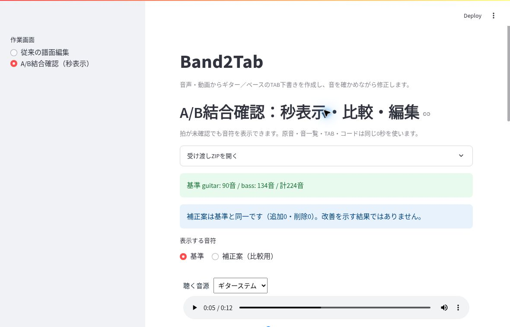

# A/B小セット結合：実装と確認記録（2026-11-19）

## ブランチと入力

- 作業ブランチ：`codex/b-ab-integration-20261119`。
- 保護したB：`53beafd`。A：`7cd15bb`。マージ：`1d03d87`。
- `app.py` の競合は、Bのモデル不要編集・保存・コード解析失敗時の扱いを保持し、Aのコード比較モデルとHTML/CSV出力を取り込んで解消した。
- ZIP：3,380,045 bytes、SHA256 `ba6ebcd6a1c6f4c1f3e1f8484ef5c9c55e30a8ff3894c42f1171644a687b71ba`。
- Aの検証スクリプトとBの読込処理の両方で18ファイル・全メンバーSHA256を確認。
- ZIP内音源・生JSON・重み・認証はGitに追加しない。展開先はGit除外済み `inputs/`、結果は `results/`。

## 再推論しない読込と秒表示

`python scripts/b_prepare_ab_integration.py ZIPの絶対パス` で検証、展開、秒単位の保存・再読込、保存済みHTMLデモ作成を行う。
`BAND2TAB_MODE=integration BAND2TAB_PORT=8502 ./Band2Tab.command` で結合画面を開く。
通常の起動では従来の編集画面が既定。左の「作業画面」から切り替えることもできる。

- 原音sample 0を0秒とし、元曲の73.5671125秒を加算しない。
- ギター90音・ベース134音の計224音、音高・onset・offset・velocityを保持する。
- 基準、補正案、人の修正版を別に保持。今回の補正案は完全一致で、追加0・削除0と表示する。
- `source_analysis` などAの絶対パスは来歴として保存するだけで、そのパスを開かない。
- BPM・拍子・小節頭はnullのまま保存でき、コード推定BPMやMIDIの仮120を埋めない。
- 運指は原音時刻を保った表示用候補。未割当はxで残し、秒表示の段階では量子化しない。
- `reference/notes.json` は別枠の補助表示のみ。モデル出力への自動置換は行わない。

## 再生の連動

HTML audio要素の `currentTime` を唯一の時計として、ギター・ベースの音一覧、秒単位TAB、コード区間を更新する。
音の活動は `onset <= t < offset`、コード区間も同じ半開区間を使う。コード構成音で音符を絞らない。
原音／ギターステム／ベースステムの切替では、同じ秒と再生・一時停止状態を保持する。
画面からは秒指定・シーク・再生・停止ができる。

クラウドChromeで確認した内容：

- 基準224音と「補正案は同一」の表示。
- 5.12秒でギターG3/C4/E4、ベースA2/A3/C#4/E4、コード予測C:majを同時表示。コード外の推定音も残った。
- 再生で表示時計が5.12秒から進み、原音とステム切替後も5.12秒を保持。
- 12.000秒で音符とコードが区間外になる。
- 224音の秒単位保存・再読込が成功。
- 拍入力3欄が未入力、確認チェックなし、MusicXML保存ボタンが無効。

これはファイル時刻と表示ロジックの確認であり、分離の音響誤差やモデル時刻誤差がゼロという確認ではない。



## 1音の人による修正

編集表は1行だけ変更できる。原音・ステムを聴いた確認と修正理由を必須にし、基準から2行以上の変更は保存前に拒否する。
基準・補正案・他の223音・別パート・未確認の拍情報を保持し、修正差分を保存する。
再読込では基準・提案・出典・拍情報の不一致を拒否する。

保存後の実機確認：

```bash
.venv/bin/python scripts/b_check_ab_review.py --require-edit
```

**実際の原音を聴いて確認した修正は、利用者による実機確認待ち。**
自動テストで行った人工的な1行変更は聴取実績として扱わない。

## MusicXML

BPM・3/4または4/4・最初の小節頭（秒）を利用者が原音で確認した後にだけ出力する。
小節途中から始まる場合は、確認済みの小節頭に合わせた記譜用の前置休符を明示し、原音時刻の音符JSON/MIDIは移動しない。
JSONに `notation_preroll_seconds` と確認値を保持する。変拍子・可変テンポの新規入力はこのフォームの対応範囲外。

今回のセットは3点すべて未確認との利用者回答があるため、実音源のMusicXML出力は未実施。
合成データによる小節途中の構造・元の秒時刻の保持は自動テスト済み。

## 画面から呼ぶ認識処理

既存の直接ミックス認識を残し、新しい画面では次の処理を独立した子プロセスで起動する。

|経路|モデル／環境|入力・出力|
|---|---|---|
|直接ミックス|smallまたはmedium、CPU/MPS、通常`.venv-mu-b`|先頭最大12秒→共通の16kHzモノラルFLOAT→生MIDI→秒単位JSON|
|Aの分離＋Mu|medium / CPU float32、指定した専用環境|`scripts.a_band_pipeline`→新しい解析フォルダ|
|任意の補完候補|YourMT3専用環境|`scripts.a_addition_apply`→別フォルダ。元結果を置換しない|
|同じ原音のコード|専用環境、公開5モデル|同じ`native.wav`→`chordchart.export`。音符との結合も新しい別フォルダ|

直接ミックスもAと同じ44.1kHzステレオPCM16の変換音源から平均・resample_polyで16kHzモノラルFLOATを作る。分離効果の比較では直接側もmedium / CPUにそろえ、smallと混ぜない。
Aのパイプラインと補完スクリプトのソースSHA256は受渡しmanifestと一致した。
必要なローカル重みは `docs/measurements/B_AB_MODEL_REQUIREMENTS_20261119.json` のサイズ・SHA256と照合する。
認識環境のPythonパスは仮想環境のシンボリックリンクを維持し、システムPythonへ置き換えない。
別のMacの仮想環境をコピーする処理、学習、Azure操作、重みの無条件取得は行わない。

ジョブは新しいフォルダで実行し、状態・ログを画面で確認できる。
所要時間、推論子プロセスの最大RSS、処理前後の空き容量、モデルサイズ・device・dtype・ライブラリ版を記録する。
最大RSSは `getrusage(RUSAGE_CHILDREN).ru_maxrss` をOS別にbyteへ換算した値で、UIを含む全プロセスの同時合算ピークではない。
失敗時も入力・生結果・ログを残す。

## 実機に必要なものと現在の障害

小セットの表示にはモデル一式は不要。既存のB用 `.venv` で動作する。

1. 人が聴いた1音の修正：未確認。ZIPをMacへ読み込み、原音／ステムを聴いて実施する。
2. BPM・拍子・小節頭：未確認。判明するまでMusicXMLはブロックする。
3. HaruyaのMacの分離＋medium実行：未確認。medium（約1.23GB）とDemucs重み（約55MB）、専用環境のDemucs等が必要。
4. 任意の補完候補：追加でYourMT3本体、対応するLoRA・補完器・vendorソース・専用環境が必要。
5. コードの新規認識：公開5モデルの重みと専用環境が必要。セット内コードJSONの表示は確認済み。

クラウドにもmedium等の重みがなく、実モデルでの新しい推論は実行していない。
Aの31.7秒／15.1秒はAの測定値として保持し、HaruyaのMacやsmallの測定値へ転用しない。
過去のsmallによる単独ギター12秒・3.13秒は別条件として記録する。

## 確認した検査

- 統合直前：B用26件成功。A/Bマージ直後：既存113件成功。
- 秒表示、原音時刻の保持、未確認拍の保存、1行修正の保護、改変JSONの拒否、仮想環境パス、認識コマンドと出力検証を追加。
- 全テスト122件成功、モデル不要環境でもB用35件成功。
- 実ZIPで224音の保存・再読込、基準と補正案の一致、全チェックサムを確認。
- Streamlit AppTestで読込・補正案選択・224音保存・拍ゲートを確認。
- 隔離した一時ディレクトリで、人工操作による1行修正・人の修正版表示・他223音保持を確認。
- クラウドChromeで前述の再生連動・保存・拍ゲートを確認。
- ZIP準備のクラウド測定：Linux x86_64 / Python 3.12.14、約0.283秒、当該プロセス最大RSS約45.96MB。推論・Macの測定ではない。
- Macでは `b_prepare_ab_integration.py` が仕様・準備時間・当該プロセス最大RSS・空き容量を`environment.json`へ記録する。

## デモの固定

秒単位の確認を終えるまでは、既存の69音の成功例を保持する。
小セットは準備時に保存する `review_player.html` でモデル再実行なしに再生連動を示せる。
失敗例は、拍未確認でMusicXMLがブロックされるケースと、モデル不足で認識前に停止して元結果を保持するケース。
全受入れ完了の報告は、上の未確認項目の実機結果をそろえてから行う。
