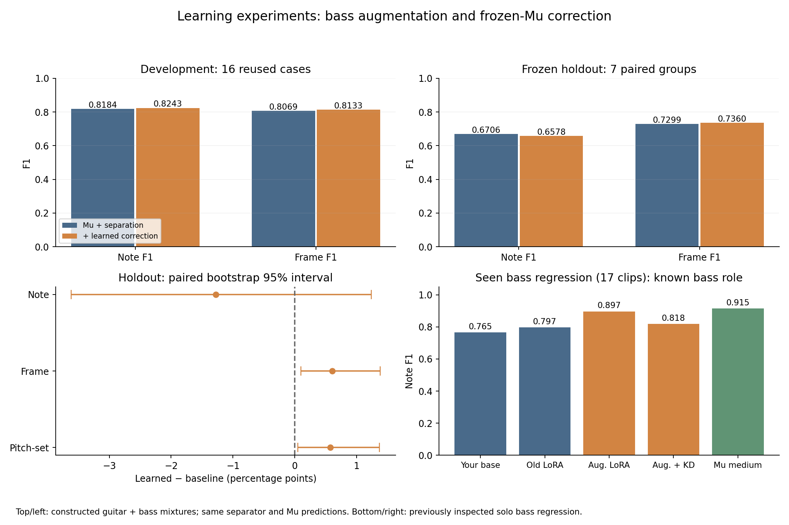

# 11月19日：歪み増強・知識保持・強い既存モデルへの上乗せ学習

## 結論

追加学習を6条件実施した（YourMT3 LoRAを2条件、MuScriptor出力の補正器を4条件）。**歪み・短い減衰音の増強後、既知の実ベース17件の再検査で元YourMT3の音符F1が0.7649→0.8962へ改善した。** 一方、固定したMu補正器の別演奏評価では、**時刻ごとの音を当てるFrame F1は0.7299→0.7360へ改善したが、音符F1は0.6706→0.6578へ悪化した**。既存モデルを全面的に超えたとは言わない。補正の全自動適用は保留し、分離＋MuScriptorを基準に原結果と補正案を比較できる構成とする。

小さい検証集合への適合が起こること、音の持続時間を改善しても開始時刻を壊すことがあることを、比較実験で確認した。発表では改善だけでなく、この失敗と次の仮説まで示す。

## 検証した仮説と結果

| 仮説 | 変更したもの | 比較・判断 |
|---|---|---|
| 歪みや短い減衰音への学習不足を補う | 正解付きSlakhベースからdry／drive／damped／damped+driveを作り、既存LoRAへ追加学習 | 共通67条件で確認。データ増強と追加更新を一式で変えているため、増強だけの因果効果とは断定しない |
| 実ベースへの性能を保ちながら学習できる | MUSDBのベースで元YourMT3の出力を保持する疑似教師学習を35%混ぜる | 新しい正解ラベルを得たわけではない。共通データで増強のみと比較し、悪化も記録する |
| 高精度なMuScriptorに補正を上乗せできる | 分離・Mu本体を固定し、音の真偽と開始／終了のずれを小さなNNで学習 | 検証では微改善したが、固定後の別演奏では音符開始が悪化。全自動採用しない |
| 正しい音の削除を抑えると安定する | 正例を重くし、混合音源中心の学習・乱数種を変えた再実験 | 初回の過剰削除は抑えた。持続時間改善と開始認識低下の両方が残った |

## 自分たちが実際に学習させた部分

**教師あり深層学習であり、強化学習ではない。** 強化学習に必要な行動・環境・報酬からの学習は行っていない。既存モデルも深層学習を使っているので、「深層学習を使うか否か」ではなく、どの誤りをどの教師で減らすかが実験の中心になる。

1. **YourMT3+のLoRA**：元の47,078,022パラメータは固定し、追加した2,351,104パラメータを更新する。正解は既存データの楽器・音高・開始・終了。新しい2条件とも、既存の混合音学習済み重みから開始し、同じ学習率3e-5と同じ増強教材を使った。増強のみは1,200試行、知識保持ありは1,850試行（正解教師1,203、疑似教師647。実更新1,847）。正解教師の機会をおおむね合わせた比較で、計算量を完全一致させた比較ではない。累計LoRA実験は13条件。
2. **MuScriptor補正器**：本体を固定し、各音符について350次元の特徴から「残す確率」と開始・終了の補正量を予測する。特徴は元ミックス／分離ギター／分離ベースのCQT、倍音周辺、音の長さ、音量包絡の変化等で、正解ラベルは入力しない。標準版53,635パラメータ、小型版24,771パラメータ。音符の真偽には重み付き交差エントロピー、時刻のずれにはHuber損失を使う。重みを最適化しており、単なる手作業の閾値調整ではない。ただし適用閾値は検証データで選ぶ。
3. **保持学習の疑似教師**：正解がない実音で、固定した元YourMT3の音符トークンと出力分布を保存した。追加モデルがそこから離れすぎないようKL損失等を与える。元モデルの誤りも保持し得るので、正解教師の代用や精度向上の証拠にはしない。

補正器は元モデルが取りこぼした新しい音高を追加できない。この上限があり、学習回数を増やすだけで完全な採譜へ到達するモデルではない。

LoRA2条件の追加学習と補正用の分離・予測生成はAzure GPUで実施した。回収後の小型補正器4条件はMac CPUで学習し、GPUを止めたまま比較できた。最終評価もMac CPUで行い、実際の利用環境で動くことを確認した。

## 教材と増強

| 用途 | 今回使ったデータ | 注意点 |
|---|---|---|
| 増強 | Slakhの元の正解付きベース。30学習元曲／8検証元曲、204学習条件／28検証条件 | 分離器が作った音に元ステムの正解を無条件で貼ったものではない |
| 歪み | 時刻をずらさないtanh飽和 | 合成歪み。実際のアンプ・弾き方の全変化を再現しない |
| 短い減衰 | 単旋律の音に減衰包絡を付与 | 音声と終了ラベルを一緒に変更。重なりのある例は除外。実録パームミュートと同等とは言わない |
| 実ベース保持 | MUSDB18の7秒版から公式train内32件／公式validation内8件 | 正解音符なし。公式testは取得対象に入れていない。120窓の予測キャッシュから、発音予測のある学習51窓を使用 |
| 補正器 | GOAT学習演奏47件のclean／noisy対94条件＋増強ベース54条件 | train148条件・val16条件。noisyは別曲の歌とドラムを足した人工ミックス |
| 固定後評価 | GOAT test演奏7件×clean／noisy＝14条件 | 7つの対であり、独立した14曲ではない。FiloBassは学習外奏者の別時刻だが同じ録音の他区間は以前確認済み |

FiloBassは主にコントラバスの実演で、歪んだエレキベースの代用とはならない。MUSDBの実ベースには正解がなく、Slakhの増強は合成音。この領域差が残る。GOATは承認済みデータを利用し、認証URLや音源はGitへ入れない。元音源・元ラベルは変更しない。

補正器用の教材は148条件だが、最終候補に選んだ小型補正器は、そのうち混合音の94条件だけで学習した。音量等の標準化も学習側だけから計算し、検証側の統計を学習へ混ぜていない。

同じ演奏の音色違い・増強違いをtrainとvalへ分けると、実力以上によく見える。そのため元曲・演奏・奏者に基づく分割を維持した。事前学習モデルが過去に見た音源との完全な重複排除までは保証できない。

## 比較結果

### 共通67条件のMac評価

<!-- COMMON_TABLE_START -->
| 同一67条件・開発検証 | 音符F1 | Frame F1 | 全音一致 | 終了込みF1 |
|---|---:|---:|---:|---:|
| YourMT3 base | 0.7525 | 0.7235 | 0.4090 | 0.6155 |
| Previous selected LoRA | 0.8632 | 0.8333 | 0.5556 | 0.7342 |
| Band-trained parent | 0.8540 | 0.8335 | 0.5567 | 0.7247 |
| Augmentation LoRA | 0.8610 | 0.8353 | 0.5637 | 0.7285 |
| Augmentation + retention | 0.8424 | 0.8137 | 0.5354 | 0.7070 |
<!-- COMMON_TABLE_END -->

この67条件は繰り返し使う**開発用検証**。最終テストではない。新しい2条件のGPU中間評価は28条件（以前の20条件＋増強8条件）なので、過去の20条件の値と直接比較しない。MuScriptorとの優劣は、別の同一入力比較で測る。

67条件はGuitarSet・BabySlakh・FiloBass・新しいSlakh・GOATおよび人工ミックスから成る9データセット群。各群の条件平均を求めてから群を均等に平均する。67件を単純に一括平均した値ではなく、件数の多い合成音だけで成績を上げない集計である。

### 以前に失敗した実ベースの再検査

以前のIDMT実ベース17件も、モデルを固定したうえで再検査した。これはミュート失敗の原因を考える際にすでに見たデータであり、**未使用の最終テストではない**。学習データへは入れない。学習量や音色増強を変えた今回のモデルで、前の失敗が残るかを調べる。

<!-- REGRESSION_TABLE_START -->
| 既知の実ベース17件・再検査 | GM分類のまま音符F1 | ベース既知の音符F1 | ベース既知のFrame F1 | ミュート4件・ベース既知音符F1 |
|---|---:|---:|---:|---:|
| YourMT3 base | 0.7649 | 0.7649 | 0.6688 | 0.8748 |
| Previous LoRA | 0.7398 | 0.7967 | 0.7378 | 0.5965 |
| Augmentation LoRA | 0.8962 | 0.8972 | 0.8326 | 0.8686 |
| Augmentation + retention | 0.8180 | 0.8180 | 0.7186 | 0.8390 |
| MuScriptor medium | 0.8613 | 0.9154 | 0.8210 | 0.8912 |
<!-- REGRESSION_TABLE_END -->

「GM分類のまま」はモデルの楽器分類も採点する。「ベース既知」は単独ベース音源という入力条件を全手法へ同じように与え、ドラム以外をベースとして読む。読み取り方を変えた差を、学習そのものの効果と取り違えない。MuScriptorにも両方の読み方を用意した。同じ17件を何度も使っていることと、17人・17曲の実バンド評価ではないことを発表で明示する。

増強後YourMT3は元YourMT3に対して大きく改善した。一方、ベース既知条件のMuScriptorは音符F1が約0.9154で、増強後YourMT3の約0.8972を上回る。Frame F1では増強後YourMT3が約0.8326、Muが約0.8210。したがって「既存モデル全般に勝った」ではなく、「音の持続を捉える指標では強い既存モデルよりよい条件が得られたが、音符開始では優位を確認できない」とする。

保持学習を加えたモデルの17件音符F1は約0.8180で、増強のみの約0.8962より低い。疑似教師の誤りを残すことや、保持の比重が強すぎることが原因候補。ただし、この比較だけで原因を特定したとは言わない。追加データを増やすこと自体を成功とせず、今回は保持学習を優先採用しない。

### 強い既存モデルを基準にした上乗せ評価

同じ16検証条件の歌・ドラム入り8件では、原音のMuScriptorが音符F1約0.2779、6パート分離して個別採譜すると0.7852。ここは**前処理の効果**で、独自学習の効果ではない。Mu＋分離器が強い基準となり、YourMT3との単純な楽器別混合でも改善しなかった。

4補正学習・計252設定を同じ検証16条件で比較し、clean／noisyの音符F1を下げない制約で設定を固定した。検証ではnoisy音符F1が0.7852→0.7938。多くの設定から選んだため、この差だけでは成功と判定しない。

その後、別のギター演奏7件で固定評価した。基準と追加モデルの**分離音・Muの予測・楽器の読み取り方は同じ**。役割が既知の推定ステムでは、ドラム以外の予測音をそのギター／ベースへ割り当てる。

| 固定後の14条件平均 | 分離＋Mu | ＋学習した補正 | 差 |
|---|---:|---:|---:|
| 音符F1 | 0.6706 | 0.6578 | −0.0128 |
| 時刻ごとの楽器・音高 Frame F1 | 0.7299 | 0.7360 | ＋0.0061 |
| 楽器を区別しない音高集合F1 | 0.7335 | 0.7393 | ＋0.0057 |
| 活動時刻の全音集合完全一致率 | 0.3264 | 0.3354 | ＋0.0090 |
| 終了も含む音符F1 | 0.5780 | 0.5683 | −0.0097 |

Frame F1の差の演奏単位ブートストラップ95%区間は約[＋0.0009, ＋0.0138]、音符F1は[−0.0362, ＋0.0124]。7演奏しかなく、同じベース素材を使う条件もある。この区間から実バンド全般への統計的優越を主張しない。

楽器別の事後的な内訳では、ギター音符F1が0.5812→0.5611、ベースが0.7784→0.7842。Frame F1はギター0.6134→0.6189、ベース0.8336→0.8450。この内訳を見て「ベースだけ適用」を最終結果の勝者として選び直すことはしない。次の別プロトコルで検証すべき仮説として扱う。

### 指標の読み方

- **音符F1**：音高・楽器・開始が正しいか。開始の許容誤差は50ms。連打を含む演奏に重要。
- **Frame F1**：20ms刻みで、その時刻にその楽器がその音を鳴らしているか。ユーザーが希望する「今鳴っているギター＋ベース音一覧」に対応する。
- **全音集合完全一致**：鳴っている全音がそろい、余計な音もない時刻の割合。無音だけで成績を上げない。
- **終了も含む音符F1**：音の長さまで確認する。切り出しで途中終了した正解には、終了の教師を無理につけない。

F1は0〜1で大きいほどよい。Frame F1が0.736という値は「全音が73.6%の時刻で完全に正しい」という意味ではない。全音一致は別の指標。

## なぜ難しいか／次の学習の意図

周波数解析の強い山は、基音だけでなく倍音・歪み・歌声・打撃音を含む。低いギターと高いベースも重なるので、固定の周波数カットでは分離できない。分離器にも音の欠落や漏れがある。CQTは音階に沿う特徴を作る処理で、それ自体が音符の正解を出すAIではない。YourMT3本体の入力はCQTではなくSTFT由来の特徴である。

最終評価では削除は少数だったが、開始時刻を動かしたことで音符の照合が悪化した。持続中の音高集合が改善しても、TABの音符開始は悪くなる。この二つを一つの精度値に隠さない。

次は①もともと合っている開始を保護して終了だけを学ぶ比較、②ギターの未検出音を補う候補生成、③分離後の歪みギターを複数音色で学ぶ比較を優先する。学習量だけを増やす方針にはしない。既存の正解音源を使った音色増強は有効な候補だが、弾き方・ノートの重なり・ラベルの同期も変わらないか確認する。新しい録音データが加わらない増強の限界も測る。

今回の14条件を見て学習し直す場合は、以後これを開発データとして扱い、再び未使用テストと呼ばない。GOAT test7演奏の3音色21条件も元演奏が同じなので、以前の32条件がすべて未使用のままとは言わない。残る未開封Slakh11条件は別の固定評価用に保留する。

## 発表で示せる価値と残る範囲

先行研究のモデルを一から作り直すのではなく、強い既存モデルを同一条件の基準に置き、少量の教師で何が改善し何を壊すかを測った点に実験上の価値がある。特に、ギター＋ベースの同時音一覧に必要な時間方向の改善を示し、音符開始とのトレードオフを可視化できた。新規アーキテクチャの世界最高精度や、完成した自動採譜を主張する成果ではない。

音声／動画の取り込み→分離→採譜→補正前後のJSONまでMacで実行確認した。担当BはこのJSONを表示・編集へ接続できる。TABの運指、リズム量子化、チョーキング等の奏法、複雑なコード名の精度は今回の実験で検証していない。コード候補に含まれない旋律音も消さずに表示する。

11月25日までの優先順位は、11/19〜20にAが開始保護・ギター候補の比較を別プロトコルで準備、Bがローカル認識処理を画面へ接続、11/21〜22に固定した手法を未使用条件で評価、11/23に修正可能なデモを固定、11/24に図表・失敗例・発表リハーサル、11/25に発表。性能目標を満たさない機能は、確認用の提案として明示する。

## 保存・実行確認

Azureから11,450ファイル・12,620,361,106 bytesを回収し全SHA-256を照合。449チェックポイントも照合した。AzureはポータルとCLIの両方で**停止済み（割り当て解除）**を確認。制限中に停止操作ができず稼働が残ったため、本人の許可でCLIを接続し、実験の終了処理にバックアップと割り当て解除を組み込めるようにした。停止失敗を成功扱いしないテストも追加した。

実行場所・入力方法・Bへの接続・終了処理は[Mac統合手順](MAC_BAND_HANDOFF.md)。集計の再作成は`PYTHONPATH="$PWD" .venv-yourmt3/bin/python -m scripts.a_retention_report`。学習・モデル選択・最終評価には固定マニフェストとハッシュを保存し、既存実験を黙って上書きしない。

主な先行実装・データ：[YourMT3+](https://github.com/mimbres/YourMT3)、[MuScriptor](https://github.com/muscriptor/muscriptor)、[Demucs](https://github.com/facebookresearch/demucs)、[GOAT論文](https://arxiv.org/abs/2509.22655)、[Slakh](https://www.slakh.com/)、[MUSDB](https://sigsep.github.io/datasets/musdb.html)。今回の数値はこれらの論文の成績ではなく、本プロジェクトの独自の条件・分割で測った値。
