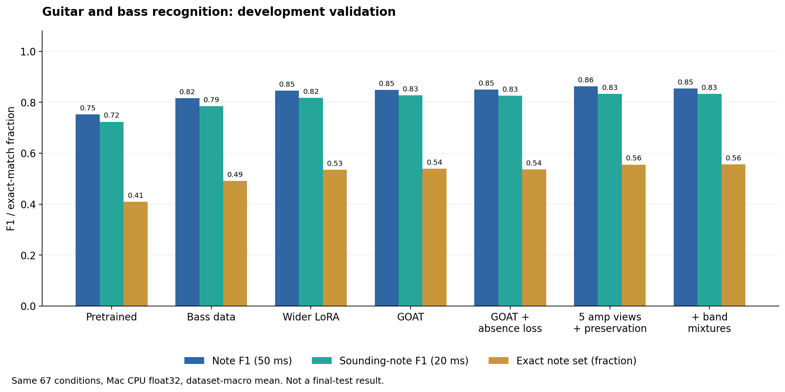

# GOAT・歌声／ドラム干渉を含む追加学習と検証

## 今回確認したこと

既存の高精度モデルYourMT3+に、ギター・ベース用のLoRAを追加して教師あり学習している。独自モデルを一から学習して公開モデルと競わせる構成ではない。元の47,078,022パラメータは固定し、広い層へ追加した2,351,104パラメータを学習する。強化学習は行っていない。

学習の教師は、既存データセットの「音高・開始時刻・終了時刻・楽器」の正解。モデルが出した音符列と正解との差を小さくする。歌声入り教材では、歌声の音符をギター／ベースとして出力しないことも、この正解との差から学ぶ。他楽器の正解がないバンド音源で、他楽器がすべて無音だと誤って教えることはしない。

YourMT3+は16kHzの波形からSTFTの対数スペクトログラムを作り、約2.048秒ずつ音符トークンへ変換する。CQTを外部で作ってこのモデルへ渡す方式ではない。分離器Demucsは学習済み重みを固定して使う。音源分離と追加学習の効果は、別の比較として測る。

周波数の強い山を1つ拾うだけでは、基音と倍音を取り違える。ギターとベースの音域も重なるので、低域をすべてベース、中高域をすべてギターに分けるだけでは不十分。モデルは倍音の並び、音色、立ち上がり、前後の変化を使って楽器と音高を推定する。複数の音符を同じ時刻に出力できるため、単音・2音・それ以上の同時発音を表現できる。ただし、表現できることと正しく認識できることは別で、以下の音符／同時発音の評価で確認する。コード名の推定は、この音符推定とは別のタスクである。

## 正解付きデータと分割

| データ | 今回の役割 | 注意点 |
|---|---|---|
| GuitarSet、Guitar-TECHS、FiloBass | 実演奏の音符学習、単独／混合音の検証 | 演奏者の分割を保持。区間を増やしても演奏者数は増えない |
| Slakh | 正解MIDIのある合成バンド | 公開YourMT3+の事前学習との重複を完全には除外できない |
| GOAT | 実際のエレキギター、DI・アンプ音色 | 承認済みの研究利用。訓練47演奏、検証8演奏、公式評価7演奏 |
| MUSDB18の公式7秒サンプル | 歌声・ドラムの干渉音 | ギター／ベース音符の教師には使わない。学習6曲、検証2曲、評価用2曲を分離 |

GOATの訓練候補item_96は音声とMIDIの長さが一致しないため全音色を隔離した。評価結果を見て都合の悪い曲を除外したものではない。検証用player2は訓練に含めない。公式評価のplayer1は別の訓練演奏にも存在し、楽曲名も匿名なので「奏者も楽曲も完全に未知」とは主張しない。

GOATのアンプ音色を1種類から5種類に増やした段階で、既存データと合わせて1,120区間・約361分になった。これは同じ演奏の音色違いを含む延べ時間。独立した361分の新曲を集めた意味ではない。

さらに、学習側だけのGOAT音源とFiloBassを重ね、MUSDBの学習側歌声・ドラムを足す教材を用意した。47演奏から2区間／音色条件ずつ選び、干渉なし／ありの188条件・約21.9分を作る。元の音符と境界の切断情報を保持し、音高やタイミングを予測に合わせて変更しない。376窓で音符トークンの復元を確認し、最大172トークンで上限256内に収まった。

## 同じMac・同じ67検証条件での比較

下表はCPU・float32で比較した開発用の検証結果。学習や設定選択に使った検証なので、最終評価の正解率として扱わない。データセットごとに平均してから、各データセットを同じ重みで平均している。

| モデル | 音符F1 | 発音中の音F1 | 全音の完全一致 |
|---|---:|---:|---:|
| 公開YourMT3+そのまま | 0.7525 | 0.7235 | 0.4090 |
| 実演奏ベースを追加学習 | 0.8161 | 0.7855 | 0.4907 |
| 学習するLoRAの層を拡大 | 0.8456 | 0.8172 | 0.5348 |
| GOATのDI・アンプ音を追加学習 | 0.8481 | 0.8279 | 0.5388 |
| アンプ5通りへ拡張＋元モデル保持を強化 | 0.8632 | 0.8333 | 0.5556 |
| さらに歌声・ドラム入りの混合教材で学習 | 0.8540 | 0.8335 | 0.5567 |

音符F1は、余分な音と取りこぼしの両方を考慮する指標で、単純な「正解した音の割合」ではない。音高と楽器が正しく、開始時刻が原則50ms以内の音符を対応付ける。発音中の音F1は20msごとの楽器・音高の一致を測る。完全一致は、その時点の音の集合がすべて正しかった活動フレームの割合。後二者の音域は従来実験と共通のMIDI 23〜88。音符F1は範囲外も数える。

GOATのアンプ音だけでは音符F1が0.5185から0.6757へ改善した一方、GuitarSetでは0.8981から0.8439、新しいSlakh検証では0.9307から0.8711へ下がった。音色への適応と元の能力の保持が両立していない。今回、低い学習率と強い元モデル保持損失も試す理由である。

5音色への拡張・学習率3e-5・保持損失係数1.0の継続学習では、GuitarSetが0.8931、新しいSlakh検証が0.8961まで戻った。GOATアンプ音は0.6806で、複雑なギターの改善幅自体は小さい。学習データ・学習率・保持損失を同時に変更した条件なので、改善を音色数だけの効果とは言わない。20条件の途中確認の音符F1は0.8954だが、報告の主値は67条件で再計算した0.8632を使う。

混合教材188条件を足した1,000回の試行では、全体の音符F1は0.8540となり、67条件の総合指標も5通りのアンプ版を超えなかった。開発用に選んだのは`goat_amp5_preserve_r8`の2,000回時点。`models/yourmt3_lora_development.pt`へ書き出し、最終評価用データのロックは解除していない。新しい条件を無条件に採用せず、改善と回帰の両方を比較した。

比較図は`reports/figures/goat_band_validation_20261118.png`と同名SVG。グラフ作成の任意依存関係は`requirements-plots.txt`、音声推論は`requirements-yourmt3.txt`。どちらも検証済みのNumPy 1.26.4を固定し、更新後の依存整合性検査と57件のテストを通した。

MuScriptor mediumのGOATアンプ検証は約0.7883で、上記LoRAの0.6757より良い。計算機・精度設定が異なるため厳密な同条件比較ではないが、LoRAがすべての既存モデルを上回ったとは言えない。追加学習の効果の主比較は、同じMac上のYourMT3+そのままと、同じモデルにLoRAを加えた結果とする。

## 歌声・ドラムと音源分離の検証

検証用GOATのアンプ音8演奏と、検証用FiloBassを組み合わせ、検証用MUSDB歌声・ドラムを加えた。干渉なし／ありで16条件。同じ8演奏を共有するため、16曲の独立したバンド録音ではない。異なる曲を合成した厳しいストレス検証で、自然なバンド曲の性能を直接表すものでもない。

| 追加学習済みモデルへの入力 | 干渉なし：音符F1 | 歌声・ドラムあり：音符F1 |
|---|---:|---:|
| ミックスを直接解析 | 0.6441 | 0.5175 |
| 4パート分離後、bass+otherを解析 | 0.6528 | 0.4747 |
| 6パート分離後、bass+guitarを混ぜ直して解析 | 0.6416 | 0.5276 |
| 6パート分離後、ギター・ベースを個別に解析 | 0.7253 | 0.5954 |

最後の方法では、ギター音声からギターとして予測した音、ベース音声からベースとして予測した音を採用する。他楽器の予測音を強制的にギターへ読み替えていない。分離なし、4パート、6パートの各条件は同じ正解で評価した。

分離は余分な音を減らす一方、ギターの弱い音も消す。そのため「ドラムとボーカルを除けば必ず精度が上がる」という前提は置かない。分離前後を確認できる入力経路を残し、単一経路を全曲に強制する採用判断は保留する。

混合教材による追加学習後は、同じ8組の干渉あり条件で次の結果になった。

| モデル／入力 | 音符F1 | 発音中の音F1 | 全音の完全一致 |
|---|---:|---:|---:|
| 5通りのアンプ版／ミックス直接 | 0.4833 | 0.5472 | 0.1381 |
| 混合教材追加版／ミックス直接 | 0.5445 | 0.6153 | 0.2731 |
| 5通りのアンプ版／6パート分離・個別解析 | 0.6186 | 0.6702 | 0.2371 |
| 混合教材追加版／6パート分離・個別解析 | 0.6766 | 0.7082 | 0.3156 |

分離・個別解析を固定した追加学習の音符F1差は+0.0581。ただし8組を再抽出した探索的区間は約−0.015〜+0.161で、改善が広く確実に再現する有意差の証明ではない。検証を繰り返しており、背景音も2曲だけなので、独立した素材を増やす必要がある。未学習モデルへ同じ分離を使った場合は音符F1 0.2703だった。分離と学習は組み合わせて評価する必要がある。

混合音向けの試用重みは`models/yourmt3_lora_band_development.pt`と同名JSONへ別に保存した。広い67条件で選んだ重みとは区別する。どちらも自動適用を無効にした開発用の重みで、既存アプリの既定エンジンは変更していない。6パート分離器はAzureで実行したもので、Macアプリの分離から譜面出力までを確認済みという意味ではない。

## 実エレキベースによる追加の点検

[IDMT-SMT-Bass-Single-Track](https://www.idmt.fraunhofer.de/en/publications/datasets/bass_lines.html)も評価用に取得した。17の短いベース演奏・計約352秒で、音高・開始／終了・弦・フレット・奏法の正解がある。公式ZIP約20.5MBは全体のMD5と個別ファイルのCRC／SHA256を確認し、原本を保持する。配布元の用途に沿い、このプロジェクトでは学習に使わない。

開発用の重みを67条件で選び終えた後、その固定した重みと公開モデルだけを比較する。17人の新しい奏者やバンド曲を用意した意味ではなく、公開重みの事前学習との重複も未確認。デッドノートやベンド等の原ラベルを残すため、固定音高の音符指標だけでは奏法全体を評価できない。結果を見てモデルを選び直すためのデータとは扱わない。

| 17件の外部スナップショット評価 | 音符F1 | 発音中の音F1 | 全音の完全一致 | 終了時刻も含む音符F1 |
|---|---:|---:|---:|---:|
| 公開YourMT3+ | 0.7649 | 0.6671 | 0.5436 | 0.5244 |
| 67条件で先に選んだ追加学習版 | 0.7398 | 0.6913 | 0.6036 | 0.5744 |

音符F1は悪化し、持続中の音と終了時刻の指標は改善した。特にミュート奏法4録音の音符F1は0.8748→0.4685、正解214音に対するベースの取りこぼしは30→137へ増えた。一方、指弾き7録音は0.7704→0.8329、ピック弾き3録音は0.7732→0.9502、スラップ3録音は0.5973→0.6740。奏法ごとの偏りがあるため、平均値だけで全エレキベースへ採用できない。

ミュート音の弱い／短い立ち上がりへの適応不足や、追加学習で元の認識を変えてしまった可能性がある。これは原因候補で、音色・音量・奏法の個別効果をまだ分離できていない。元の重みを固定するLoRAでも、追加行列によって予測は変わるため、以前の能力が自動的に保たれるわけではない。IDMTの評価用音源をこの結果に合わせた学習へ混ぜない。

## A・Bの接続と次の検証

Aは学習・評価・音符データ出力を担当する。Bは、その同じ`parts.guitar`・`parts.bass`形式を受け取り、同時発音の表示、修正、運指、譜面表示を担当する。音符モデルの変更でB側を全面的に作り直す必要はない。原音は上書きせず、秒単位の音符と元の音を残す。

生MIDIの120 BPMは仮の値で、拍を推定した結果ではない。TABのリズム表示には、別の拍／小節検出または確認したBPMを使う。音高が当たっても同音異弦の正解は一意に決まらない。複数ギターの重なり、ベンド、スライド、音の長さ、コード名、運指の弾きやすさは別途検証する。

混合教材の追加学習と、既存67条件・ストレス16条件・別の実ベース17件の比較まで実施した。最終評価の新Slakh11曲・GOAT公式7演奏／21音響条件は引き続きロックしている。今回の結果だけでは自然なバンド全般の実用精度や、無修正の完成TABを約束できない。

次に優先する作業は、(1) ミュート等の実ベース音を含む学習側素材で元モデルの予測を保つ損失を検証すること、(2) 現在ギター単体で強いMuScriptorと追加学習版のベースを組み合わせ、同じ分離済み素材で比較すること、(3) 独立した演奏・背景で再確認してから条件を固定し、未使用の32評価条件を開くこと。未ラベルのMUSDB／MoisesDB音源を使う場合は、教師モデルの擬似ラベル／保持用と明示し、空の正解音符として学習させない。学習回数だけを増やすより、今回悪化した奏法と元モデルの保持を直接扱う。

自分たちの現時点の価値は、新しい万能な採譜方式の発明ではなく、公開モデルへの特化学習・不要楽器の分離・音符列の保持を組み合わせ、その効果と失敗条件を同じ評価手順で示した点にある。将来のTABアプリでは、予測差を原音と比較して修正できることまで含め、修正時間と弾きやすさを評価する必要がある。

Azureの今回のGPU作業は終了した。445チェックポイントと今回の9,408実験ファイル約11.78GBをMacへ回収してSHA256一致を確認し、「停止済み（割り当て解除）」を実画面で確認した。Mac用コマンドでも選択した重みを再読込し、検証時と同じ音符が出ること、原音が変わらないことを確認した。停止確認は`reports/azure_goat_band_deallocated_20261118.jpg`、動作確認は`reports/yourmt3/development_cli_smoke.json`。

実測は`reports/yourmt3/mac_validation/*/comparison.json`、`reports/band_stress_v1/*/comparison.json`。`scripts/a_learning_review.py`は同じ入力の推定結果を比較し、元演奏ごとにまとめた探索的なブートストラップ区間と、楽器別の余分な音／取りこぼしを出力する。繰り返し選択後の検証に対する区間であり、有意差の確証とは扱わない。

参考： [YourMT3+](https://github.com/mimbres/YourMT3)、[GOAT公式配布](https://zenodo.org/records/15690894)、[GOAT論文](https://arxiv.org/html/2509.22655v1)、[MUSDB公式7秒サンプル](https://zenodo.org/records/1256064)。個人用認証URLは公開しない。
